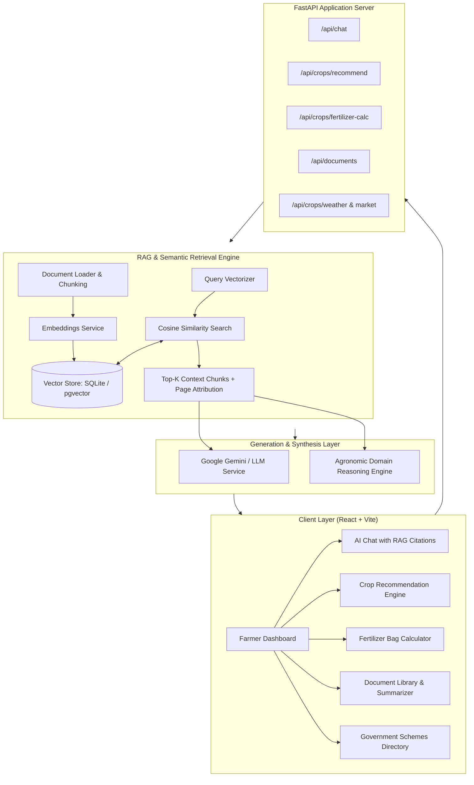

# 🌾 AgriAI — AI Smart Farming Assistant Using Retrieval-Augmented Generation (RAG)

[](https://fastapi.tiangolo.com/)
[](https://reactjs.org/)
[](https://vitejs.dev/)
[](https://python.org/)
[](https://opensource.org/licenses/MIT)

> **Empowering farmers with trusted, context-aware agricultural intelligence through Retrieval-Augmented Generation (RAG), agronomic science, and real-time market data.**

---

## 📌 1. Problem Statement

Farmers often face difficulties accessing accurate, reliable, and timely information regarding:
* **Crop selection & agronomic suitability** based on regional soil chemistry and microclimates.
* **Balanced fertilizer schedules** (avoiding over-application and soil salinity while optimizing N-P-K costs).
* **Water management & irrigation scheduling** under varying seasonal water availability.
* **Timely pest & disease diagnosis** with exact biological and chemical thresholds (ETL).
* **Government farming schemes & subsidies** (e.g., PM-KISAN, PMFBY crop insurance, micro-irrigation grants).

Traditional agricultural information is heavily fragmented across complex technical manuals, disparate government portals, and extension brochures. Furthermore, **general-purpose commercial LLM chatbots frequently hallucinate or produce generic, unsupported advice** when stripped of verified regional agronomic resources. 

---

## 💡 2. Solution: The AgriAI Platform

**AgriAI** solves this challenge by pairing authoritative agricultural manuals (ICAR, Ministry of Agriculture, State Agricultural Universities) with a high-accuracy **Retrieval-Augmented Generation (RAG)** pipeline:

1. **Document Ingestion & Chunking:** Agricultural manuals and packages of practice are broken down into semantically cohesive passages, retaining section titles, tables, and page markers.
2. **Dense Vector Embeddings:** Text chunks are vectorized using dense semantic embeddings and indexed in a vector store (supporting both PostgreSQL with `pgvector` and an embedded zero-friction vector engine).
3. **Contextual Retrieval:** Natural language farmer questions trigger cosine similarity and semantic keyword search to fetch the top-ranked ground-truth chunks.
4. **Grounded Generation & Source Attribution:** A specialized Generative AI model synthesizes clear, actionable farmer recommendations with explicit citations (document name, page number, and confidence score).
5. **Interactive Agronomic Tooling:** Built-in calculators for crop profitability ranking, fertilizer bag conversions (Urea, DAP, MOP), pest treatment lookup, and live APMC Mandi market tickers.

---

## 🏛️ 3. System Architecture



---

## 📂 4. Project Directory Structure

```text
smart-farming-assistant/
├── frontend/                     # Modern React + Vite frontend application
│   ├── public/                   # Static assets & icons
│   ├── src/
│   │   ├── components/           # Reusable UI widgets (Header, Sidebar, Modals)
│   │   ├── pages/                # Views (Dashboard, Chat, Crops, Fertilizer, etc.)
│   │   ├── services/             # Axios API client services
│   │   ├── App.jsx               # Main application router and state
│   │   ├── index.css             # Lush emerald agricultural design system
│   │   └── main.jsx              # React DOM entry point
│   ├── package.json
│   └── vite.config.js
├── backend/                      # Production-ready Python FastAPI server
│   ├── main.py                   # FastAPI app entry point & startup auto-indexer
│   ├── database.py               # Database layer (SQLite & pgvector support)
│   ├── requirements.txt          # Python package dependencies
│   ├── rag/
│   │   ├── document_loader.py    # Chunking, header extraction & page calculation
│   │   ├── embeddings.py         # 128-d Agronomic Semantic Vectorizer & API client
│   │   └── retriever.py          # Similarity search & source attribution formatting
│   ├── routes/
│   │   ├── chat.py               # RAG chat, session history & recent queries API
│   │   ├── crops.py              # Crop recommendations, fertilizer, pests, schemes
│   │   └── documents.py          # Document upload, listing, and AI summarization
│   └── services/
│       └── llm_service.py        # Gemini API client & Grounded Reasoning Engine
├── documents/                    # Trusted agricultural reference manuals
│   ├── Rice_Cultivation_Manual.txt
│   ├── Soil_Health_Guide.txt
│   ├── Pest_Management.txt
│   ├── Government_Schemes.txt
│   ├── Fertilizer_Recommendation.txt
│   └── Drip_Irrigation_Handbook.txt
└── README.md                     # Comprehensive project documentation
```

---

## ⚡ 5. Quick Start Guide

### Prerequisites
* **Python 3.10+** (Python 3.11, 3.12, 3.13 tested)
* **Node.js 18+** and **npm**

---

### Step 1: Start the Backend Server

```bash
cd smart-farming-assistant/backend

# 1. Install dependencies
pip install -r requirements.txt

# 2. (Optional) Set your Gemini API key for external LLM inference
# If not set, the system automatically uses its built-in Grounded Agronomic Reasoning Engine!
set GEMINI_API_KEY=your_gemini_api_key_here

# 3. Start the FastAPI development server
python -m uvicorn main:app --host 127.0.0.1 --port 8000 --reload
```

The server will automatically:
* Initialize the database schema (`agri_assistant.db`).
* Read all manuals in `../documents/`.
* Chunk, embed, and index them into the vector knowledge base on the very first boot.
* Serve Swagger interactive API documentation at: **`http://127.0.0.1:8000/docs`**

---

### Step 2: Start the Frontend Client

Open a new terminal window:

```bash
cd smart-farming-assistant/frontend

# 1. Install frontend dependencies
npm install

# 2. Launch the Vite development server
npm run dev
```

Visit **`http://localhost:5173`** in your browser.

---

## 🔬 6. Core Features & Capabilities

### 1. Contextual RAG Agricultural Chatbot
* **Natural Language Queries:** Ask questions about crop cultivation, nutrient deficiencies, pest control, and subsidies.
* **Grounded Citations:** Every recommendation references the exact source document, section, and page number (e.g., `[Rice_Cultivation_Manual.pdf (Page 4)]`).
* **Interactive Source Inspecting:** Click on citation pills to view the verbatim passage retrieved from the manual.

### 2. Intelligent Crop Recommendation Engine
* Evaluates soil type, N-P-K chemical levels, pH, rainfall, and regional seasonality.
* Outputs ranked suitability scores, expected yield ranges, profitability tiers, and clear agronomic justifications.

### 3. Precision Fertilizer Dosage Calculator
* Translates elemental N-P-K recommendations into actual commercial fertilizer bags (**Urea 45kg bags, DAP 50kg bags, MOP 50kg bags, and Zinc Sulphate**).
* Provides split-dose application timelines (Basal, Active Tillering, Panicle Initiation).

### 4. Integrated Pest & Disease Diagnostic Compendium
* Identifies damaging insect pests and pathogens (Yellow Stem Borer, Fall Armyworm, Rice Blast, Pink Bollworm).
* Specifies **Economic Threshold Levels (ETL)**, biological parasitoids, and label-claim chemical formulations.

### 5. Government Schemes & Subsidies Directory
* Access updated information on **PM-KISAN**, **PMFBY (Fasal Bima)**, **PMKSY (Micro-Irrigation)**, **PKVY (Organic Farming)**, and **Kisan Credit Card (KCC)**.

### 6. Document Library & Summarization
* Upload additional agricultural guides (PDF, TXT, DOCX).
* Real-time vector chunk indexing with an automated AI summarizer that extracts key agricultural metrics and actionable farmer checklists.

---

## 📡 7. API Reference

| Endpoint | Method | Description |
| :--- | :--- | :--- |
| `/api/chat` | `POST` | Core RAG conversation endpoint with vector retrieval and source citation |
| `/api/chat/history` | `GET` | Retrieve session conversation history |
| `/api/chat/recent-queries` | `GET` | Fetch recent query feed for dashboard |
| `/api/chat/stats` | `GET` | System metrics (total queries, indexed documents, alerts) |
| `/api/crops/recommend` | `POST` | Multi-factor agronomic crop recommendation |
| `/api/crops/fertilizer-calc` | `POST` | Fertilizer bag calculator per acre |
| `/api/crops/pests` | `GET` | Pest directory with biological and chemical control |
| `/api/crops/schemes` | `GET` | Indian agricultural welfare schemes and subsidies |
| `/api/crops/market-prices` | `GET` | APMC Mandi daily modal prices and trends |
| `/api/crops/weather` | `GET` | Agro-meteorological weather and advisory |
| `/api/documents` | `GET` | List all indexed agricultural documents |
| `/api/documents/upload` | `POST` | Ingest and index new PDF or text manuals |
| `/api/documents/summarize` | `POST` | Generate executive summaries and checklists |

---

## 🌾 8. Data Sources & Acknowledgments

* **ICAR** — Indian Council of Agricultural Research (*Standard Packages of Practices*)
* **DA&FW** — Department of Agriculture & Farmers Welfare, Govt. of India
* **DPPQS** — Directorate of Plant Protection, Quarantine & Storage
* **IARI** — Indian Agricultural Research Institute

---

## 📜 9. License

This project is licensed under the MIT License — see the [LICENSE](LICENSE) file for details.
